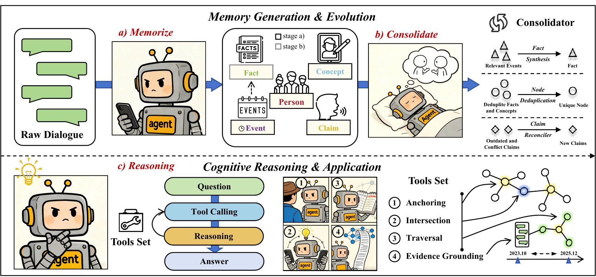

# CogMem: From Retrieval to Reconstruction

CogMem is a provenance-aware cognitive memory system for long-term dialogue. It turns dialogue into an evolvable **PEC²F** graph—**P**erson, **E**vent, **C**oncept, **C**laim, and **F**act—and uses a bounded agentic search loop to reconstruct answers from grounded evidence.

> **Pre-release notice.** This repository is being prepared for public release. The paper link and citation are intentionally omitted until the publication is formally available. Please do not treat this branch as the archival release.

[中文说明](README_zh.md)

<p align="center">
  
</p>

## Why CogMem?

Flat retrieval can conflate a speaker's attributed opinion with an event or a durable fact. CogMem keeps those forms of memory distinct and connects them with typed, time-aware edges.

| Stage | What happens |
| --- | --- |
| Memorize | Dialogue turns are extracted into typed graph records with source and timestamp metadata. |
| Consolidate | Episodic events are synthesized into durable facts while retaining links to their supporting evidence. |
| Reconstruct | A query-aware controller composes anchoring, traversal, intersection, and evidence-grounding operators. |

The design supports multi-hop reasoning, temporal queries, knowledge updates, and source-attributed claims without training a retrieval policy.

## Installation

CogMem requires Python 3.12 or later. We recommend [`uv`](https://docs.astral.sh/uv/) for reproducible environments, although `pip` works as well.

```bash
git clone https://github.com/Silent-Rain02/CogMem.git
cd CogMem
uv sync
# or: python -m pip install -e .
```

Copy the configuration template and choose one supported model provider:

```bash
cp .env.example .env
```

CogMem supports OpenAI-compatible APIs, SiliconFlow, ModelScope, and Ollama. Configure the provider and model identifiers in your application; see [configuration](#configuration). Keep `.env` private—API credentials must never be committed.

## Quick start

The following example requires a configured chat model and embedding endpoint. It creates a fresh local workspace and persists the resulting memory graph there.

```python
from cogmem import CogMem, CogMemConfig
from cogmem.storage import Doc

config = CogMemConfig()
config.model.provider = "ollama"
config.model.embedding_provider = "ollama"
config.model.ollama_chat_model = "qwen2.5:14b-instruct"
config.model.ollama_embedding_model = "bge-m3"

memory = CogMem(config=config, workspace_dir="./workspace")
memory.add_documents([
    Doc(id="turn-1", text="Alice and Bob visited the park on Saturday."),
    Doc(id="turn-2", text="Bob said that he enjoys birdwatching."),
])
memory.save()

print(memory.answer("What does Bob enjoy?"))
```

For configuration of an OpenAI-compatible endpoint, see [`.env.example`](.env.example). A runnable copy of this snippet is available at [`examples/quickstart.py`](examples/quickstart.py).

## Configuration

`CogMemConfig` keeps model, storage, extraction, and agent settings separate. Start from an independent config object rather than mutating `DEFAULT_CONFIG`:

```python
from cogmem import CogMemConfig

config = CogMemConfig()
config.model.provider = "siliconflow"
config.model.embedding_provider = "siliconflow"
config.model.siliconflow_chat_model = "Qwen/Qwen2.5-14B-Instruct"
config.model.siliconflow_embedding_model = "BAAI/bge-m3"
config.runtime.max_concurrency = 2
```

The implementation detects the embedding dimension before creating its FAISS indexes. Rebuild a workspace when switching to an embedding model with a different output dimension.

## Reproducing the experiments

CogMem includes runners for LoCoMo and LongMemEval. Exact dataset preparation, model settings, expected outputs, and the distinction between a smoke test and the full run are documented in [the reproducibility guide](docs/REPRODUCIBILITY.md).

```bash
# LoCoMo: build the memory graph, consolidate it, and evaluate.
uv run python scripts/eval_locomo_complete.py \
  --data_dir /path/to/locomo10.json \
  --workspace .cogmem/locomo \
  --output artifacts/locomo_results.json

# LongMemEval: use the benchmark's prepared JSON file.
uv run python scripts/eval_longmemeval_complete.py \
  --data_dir /path/to/longmemeval_s_cleaned.json \
  --workspace .cogmem/longmemeval \
  --output artifacts/longmemeval_results.json
```

Benchmark data is not distributed with this repository. Download LoCoMo and LongMemEval from their official sources, then pass their paths to the runners. See [`datasets/README.md`](datasets/README.md).

## Reported results

The camera-ready experimental record reports the following CogMem results. LoCoMo values are F1 / BLEU-1; LongMemEval values are LLM-as-judge accuracy. Results depend on the listed backbone, dataset version, prompts, and evaluation protocol—please use the reproduction guide rather than comparing these numbers across differently configured runs.

| Benchmark | GPT-4o-mini | Qwen2.5-14B-Instruct |
| --- | ---: | ---: |
| LoCoMo — Single Hop | 59.20 / 56.40 | 60.40 / 55.80 |
| LoCoMo — Multi Hop | 50.70 / 46.10 | 48.42 / 44.65 |
| LoCoMo — Temporal | 63.80 / 57.90 | 56.20 / 49.10 |
| LoCoMo — Open Domain | 56.10 / 51.20 | 55.80 / 50.10 |
| LongMemEval — Accuracy | 68.40 | 66.50 |

## Repository layout

```text
cogmem/       Core library: graph schema, ingestion, consolidation, and agents
datasets/     Dataset adapters and local-development dataset notes
docs/         Architecture, reproducibility, and release documentation
examples/     Small runnable examples
scripts/      Benchmark evaluation runners
tests/        Fast, offline unit tests
```

## Safety and privacy

CogMem stores potentially sensitive dialogue content, relationships, preferences, and attributed opinions. Use per-user workspaces, control access to persisted graph files, avoid logging raw conversations, and offer retention/deletion controls in any deployment. See [SECURITY.md](SECURITY.md) for a private vulnerability-reporting channel.

## Contributing

Contributions are welcome after the public release. Please read [CONTRIBUTING.md](CONTRIBUTING.md) for the development workflow and [the release checklist](docs/RELEASE_CHECKLIST.md) for the remaining publication steps.

## License

CogMem is released under the [MIT License](LICENSE).
